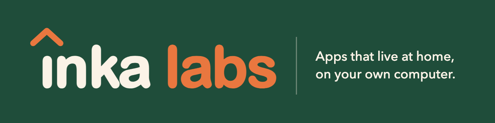

*Inka* is Ekegusii for **home**.

Inka Labs builds small, practical apps that live at home on your own computer:

- **Yours to keep**: your data stays on your machine, not on someone else's server.
- **Easy to start**: install with a double-click and open it in your browser. No account needed.
- **Built for real work**: each app starts from a job someone needed done, such as running a food business, keeping a household budget or logging training.

Projects will be listed here as they move in.
